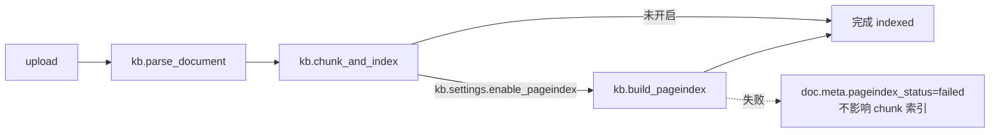

# PageIndex 检索选项 — 技术方案（设计稿）

**作者**：史强（系统分析） 2026-10-10
**依据**：`00-management-PAGEINDEX_BRIEF.md` + 现有代码（证据见文末引用清单）
**范围**：只定设计，不改代码。开发（章北海）按本文档实施；测试（云天明）按第 7 节验收点核对。

---

## 1. 总体设计决策

| # | 决策点 | 结论 | 理由 |
|---|---|---|---|
| D1 | 树存储位置 | **`document.meta["pageindex_tree"]`（复用 JSONB，不建新表）** | Document.meta 已是 JSONB（models.py:109），且现有 parse meta 就存在这里；树是文档级、单值、无独立查询需求，建表属过度设计 |
| D2 | 原文定位方式 | **字符偏移 `[start, end)`（相对 `document.full_text`）**，不引入页码 | 现有 chunker 只按结构切块、无页码概念；MinerU 输出是纯 Markdown（mineru_client.py:137-145 的 meta 无页码字段）。字符偏移简单、与 full_text 一一对应、可精确切出引用原文 |
| D3 | 是否用 PageIndex 官方 SDK | **不用 SDK，自实现**（LLM 生成树 + LLM 推理检索） | 官方 SDK 假设 PDF 页码体系且依赖其内部实现；本系统全文来自 MinerU Markdown，自实现 ~200 行，不新增依赖。`requirements.txt` 无需变动 |
| D4 | 节点与 chunk 的映射 | **树节点独立于 chunk 体系，不写 chunk 表**；retrieve 结果用 full_text 切片作 content，`chunk_id` 取节点区间内第一个已存在 chunk 的 id（找不到则取该文档 chunk_index=0 的 chunk 作溯源锚点） | 红线要求不动现有 ES/chunk 路径；chunk 表只作为 `sources` 格式的兼容锚点 |
| D5 | 建索引时机 | **Celery 链式**：`parse → chunk_index → pageindex_build`（chunk_index 成功后，KB 开启 pageindex 时触发） | 与现有链式触发模式一致（tasks.py:76 `chunk_index_task.delay`）；pageindex 失败不回滚 chunk 索引（两者独立） |
| D6 | LLM 客户端 | **复用 `llm_client`（ai_client.py:115），不新建客户端**；新增一个非流式 `chat()` 方法；PageIndex 模型名走新配置项 `pageindex_llm_model = "vllm-qwen3.8-27b"` | 现有 llm_client 的 base_url 已指向 34.121.9.233:4000（config.py:95），只缺模型名与 JSON 输出方法 |
| D7 | 检索策略（多文档 KB） | **单次 LLM 调用、全库联合推理**：把 KB 内所有文档的树摘要（含 doc_id）拼成一个 outline prompt，LLM 一次选出 top-n 节点（带 doc 归属），再按 doc 切 full_text | 比"逐文档串行调用"快且省 token；KB 文档数通常 <20，outline 总量可控。KB 文档 >50 时的降级策略见第 6 节风险 R5 |

---

## 2. 树索引 JSON Schema（节点字段 + 层级约定 + 定位）

### 2.1 存储结构

存于 `document.meta["pageindex_tree"]`：

```json
{
  "version": 1,
  "created_at": "2026-10-10T08:00:00Z",
  "model": "vllm-qwen3.8-27b",
  "full_text_chars": 28431,
  "node_count": 37,
  "build_ms": 52310,
  "status": "ok",
  "root": {
    "node_id": "n1",
    "title": "某系统使用手册",
    "summary": "本文档介绍系统的安装、配置、日常运维与故障排查。",
    "start": 0,
    "end": 28431,
    "children": [
      {
        "node_id": "n1.1",
        "title": "1. 安装部署",
        "summary": "覆盖环境要求、数据库初始化与容器启动。",
        "start": 120,
        "end": 4200,
        "children": [
          {
            "node_id": "n1.1.1",
            "title": "1.1 环境要求",
            "summary": "JDK17、MariaDB 10.6 及以上、Docker 24+。",
            "start": 200,
            "end": 900,
            "children": []
          }
        ]
      }
    ]
  }
}
```

### 2.2 节点字段定义

| 字段 | 类型 | 必填 | 说明 |
|---|---|---|---|
| `node_id` | string | 是 | 层级点分编号：`n1` → 子 `n1.1` → 孙 `n1.1.1`。检索时 LLM 只引用此 id，代码按 id 找节点，避免 LLM 复述大段文本 |
| `title` | string | 是 | 节点标题（叶节点可自拟，如"参数说明"） |
| `summary` | string | 是 | ≤80 字中文摘要；检索时作为 LLM 判定的主要依据 |
| `start` / `end` | int | 是 | 该节点覆盖的 **full_text 字符偏移区间** `[start, end)`。约束：父区间包含子区间；子区间按文档顺序递增、不重叠 |
| `children` | array | 是 | 叶子节点为 `[]` |

### 2.3 层级约定

- 深度 **2–4 层**（根层 + 最多 3 层子层），与 PageIndex 官方一致
- 每层节点数 **≤ 12**（控制 outline token；超出时 LLM 应合并相邻小节）
- 叶子节点覆盖的原文长度建议 **300–3000 字符**；超 3000 应继续拆
- 树的 `start/end` 必须整体覆盖 full_text 的有效正文（首尾允许 5% 容差）
- `status`：`ok` / `degraded`（LLM 失败、退化为规则树，见 R2）/ `failed`
- `full_text_chars` 建索引时的文本长度：**若文档后续 reparse 导致 full_text 变化，偏移失效，必须重建**（reparse 流程中强制重建，见第 5 节）

### 2.4 检索时定位引用段落

选中节点后：`content = doc.full_text[node.start : node.end]`，单节点超过 3000 字符时截前 3000 并在 metadata 标 `truncated: true`。

---

## 3. LLM Prompt 设计

模型：`vllm-qwen3.8-27b`，OpenAI 兼容 `chat.completions`。
**两个 prompt 都要求 JSON 输出**（`response_format={"type":"json_object"}`；vllm 不支持时退化为提示词约束 + 代码侧提取首个 `{...}` 块）。

### 3.1 建树 Prompt（`build_tree_index`）

**输入**：full_text（>32k 字符时按 heading 分片，每片 ≤32k，逐片生成子树后合并，见 R3）。

**System**：
```
你是文档结构分析器。你的任务是为一篇长文档生成层级树索引（类似"目录+摘要"）。
严格遵守：
1. 层级 2-4 层，每层不超过 12 个节点；
2. 每个节点必须给出 start/end 字符偏移：start 是该节点正文起始字符位置（从 0 计），
   end 是该节点正文结束字符位置（不含）；父区间必须包含子区间，同层子区间不重叠且按顺序排列；
3. 叶子节点覆盖 300-3000 字符；整棵树覆盖文档全部正文；
4. title 用原文标题（无标题处自拟简短标题），summary ≤80 字；
5. 只输出 JSON，不输出任何解释文字。
```

**User**：
```
请为以下文档生成树索引 JSON。
输出格式：
{"root": {"node_id":"n1","title":"...","summary":"...","start":0,"end":<全文长度>,
  "children":[ {"node_id":"n1.1","title":"...","summary":"...","start":..,"end":..,"children":[]} ]}}

全文长度：{{chars}}
文档开始：
<<<DOC_START>>>
{{full_text}}
<<<DOC_END>>>
```

**输出后校验（代码侧，校验失败重试 1 次）**：
- JSON 可解析且含 `root`
- 区间合法性：父⊇子、同层有序不重叠、`root.start=0`、`root.end≈full_text 长度（±5%）`
- 节点数 ≤ 100、深度 ≤ 4
- 任一不通过 → 把校验错误拼进 prompt 重试一次；再失败 → 走 R2 降级树

### 3.2 检索推理 Prompt（`retrieve`）

**输入**：KB 内各文档的 outline（由树扁平生成，每节点一行：`n1.1.1 [doc:xxx] 标题 — 摘要 (start-end)`）+ 用户问题。

**System**：
```
你是知识库检索器。给定多个文档的树索引目录（含 doc_id、节点编号、标题、摘要、字符区间）
和一个用户问题，选出最相关的节点。
严格遵守：
1. 只从给定节点中选择，node_id 必须原样引用，不得杜撰；
2. 选 1-{{top_n}} 个节点，按相关度降序；
3. 每个节点给出 relevance 分数（0-1 之间的小数，两位）；
4. 没有任何相关节点时返回空数组，不要硬凑；
5. 只输出 JSON。
```

**User**：
```
用户问题：{{question}}

文档目录：
{{outline_lines}}

输出格式：
{"selected": [{"doc_id":"...","node_id":"...","relevance":0.87}]}
```

**outline 行格式**（代码从树生成，每行 ~60 字符）：
```
[n1.1.1] doc=a3f2…c9 | 1.1 环境要求 | JDK17、MariaDB10.6+、Docker24+。 | 200-900
```

**结果后处理（代码侧）**：
1. 按 `doc_id + node_id` 回查节点；LLM 给的 node_id 不存在 → 尝试前缀匹配（`n1.1` 命中 `n1.1.1` 的父）→ 仍无则丢弃
2. `content = full_text[start:end]`（截 3000）
3. 按 `relevance` 降序取 `top_n`

---

## 4. 与现有数据模型映射 / sources 对齐

### 4.1 表/字段改动

| 对象 | 改动 | 说明 |
|---|---|---|
| `document.meta` | 新增 `pageindex_tree` 键（schema 见 §2） | 无需 DDL |
| `document.meta` | 新增 `pageindex_status`：`none / building / ok / degraded / failed` | 前端文档列表可展示索引状态 |
| `process_task.task_type` | check 约束扩为 `('parse','chunk_index','pageindex','cleanup')` | 新增迁移脚本（infra/migrations/），记录建索引任务进度 |
| `knowledge_base.settings` | 新增键 `enable_pageindex: bool`（默认 false） | JSONB 无需 DDL；`KbCreateReq`/`KbUpdateReq` 各加 `enable_pageindex: Optional[bool]`，KbOut 已透传 settings |
| `chunk` 表 / ES 索引 | **完全不动** | 红线 |

### 4.2 `retrieve()` 返回格式（对齐现有 sources）

现有 `SearchResultItem`（schemas.py:209-217）与 chat 的 `source_meta`（rag_engine.py:75-81）：

```json
{
  "chunk_id": "b7e1…(节点区间内第一个 chunk 的 id；无则该文档 chunk_index=0 的 chunk id)",
  "document_id": "a3f2…c9",
  "filename": "使用手册.pdf",
  "chunk_index": 7,
  "content": "（full_text 按节点区间切出的原文）",
  "score": 0.87,
  "match_type": "pageindex",
  "metadata": {"node_id": "n1.1.1", "node_title": "1.1 环境要求",
               "char_start": 200, "char_end": 900, "truncated": false}
}
```

- `score` = LLM 的 relevance（0-1）；search 接口 `SearchResultItem.score` 已是 float，直接兼容
- `match_type` 新增取值 `pageindex`（schemas.py:216 注释同步更新）
- `metadata` 里带 `node_id/char_start/char_end`，前端可用于"定位到段"展示（可选做）
- chat 的 `source_meta` 只取 `chunk_id/document_id/filename/chunk_index/score` 五字段（rag_engine.py:75-81），格式不变，Message.sources 落库格式不受影响

### 4.3 `pageindex_engine.py` 接口

```python
# backend/app/services/pageindex_engine.py
MAX_DOC_CHARS = 32000        # 建树单次 LLM 输入上限
MAX_OUTLINE_DOCS = 50        # 单次检索参与推理的文档数上限（R5）
MAX_CONTENT_CHARS = 3000     # 单节点引用原文截断

def build_tree_index(document: Document) -> dict:
    """生成树并写入 document.meta['pageindex_tree']，返回 meta。
    内部：分片→逐片 LLM 建树→合并→校验→降级兜底。"""

def rebuild_tree_index(document: Document) -> dict:
    """强制重建（rebuild API / reparse 钩子），先清旧树再建。"""

def retrieve(kb_id: str, question: str, top_n: int = 5,
             filters: dict | None = None) -> tuple[list[dict], int]:
    """返回 (results, took_ms)，results 元素格式见 §4.2。
    内部：查 KB 下已建树的文档（pageindex_status in ok/degraded，可按
    filters.file_type 过滤）→ 拼 outline → 单次 LLM 推理 → 切原文。"""
```

---

## 5. 摄取流程插入点（Celery 编排）



1. **新增任务** `build_pageindex_task(document_id, task_id)`（`workers/tasks.py`，queue=kb，base=KBTask）：
   - 建 `ProcessTask(task_type='pageindex')`，状态机同现有任务
   - 调 `pageindex_engine.build_tree_index(doc)`
   - **注意**：pageindex 失败**不得**把 `document.status` 置为 `failed`（chunk 已 indexed 可用），只写 `meta.pageindex_status='failed'` + `ProcessTask.error_message`
2. **触发点**：`chunk_index_task` 成功收尾处（tasks.py:168-173 之间），读 `doc.kb.settings.get("enable_pageindex", False)`，为 True 则 `build_pageindex_task.delay(...)`
3. **reparse 钩子**（documents.py:191 `reparse_doc`）：重新解析会换 full_text → 旧树偏移失效，reparse 链末尾同样触发重建（开启 pageindex 的 KB）
4. **手动重建 API**：`POST /knowledge-bases/{kb_id}/documents/{doc_id}/pageindex/rebuild`（documents.py 新增，参照 reparse 模式：鉴权 min_role=editor → 建 ProcessTask → `.delay()` → 返回 task_id）
5. **KB 开关切换**：`PUT /knowledge-bases/{kb_id}` 开启 `enable_pageindex` 时，对 KB 下已有 `status=indexed` 的文档批量 `.delay()` 建树（限制：单批 >50 个文档时只重建最近 50 个，其余靠 rebuild API，防止 LLM 风暴——见 R6）
6. **删除联动**：文档删除/KB 删除走现有 cleanup，树在 meta 里随行删除，**无需额外清理**
7. **Celery 超时**：现 `task_time_limit=600s`（celery_app.py:36），建树大文档可能逼近，`build_pageindex_task` 单独设 `time_limit=900, soft_time_limit=840`

---

## 6. 风险清单与对策

| # | 风险 | 影响 | 对策 |
|---|---|---|---|
| R1 | **LLM 调用超时**（27b 推理慢，建树 30-120s，检索 5-15s；vllm 端点为公网 IP http 无鉴权，链路可能抖动） | 建索引卡死 worker；检索拖慢 SSE | 建树：Celery 异步 + 单分片 LLM 超时 300s + 重试 2 次（指数退避）。检索：非流式 `chat()` 超时 60s，**检索阶段 LLM 失败直接返回空结果 + `took_ms` 与 error 标记，不回退 ES**（mode 是用户显式选的，静默回退会造成误解）；chat 场景由 SSE 发 `error` 事件 |
| R2 | **树退化/畸形**（LLM 输出偏移越界、区间重叠、编造节点、JSON 截断） | 引用原文错位，答非所问 | §3.1 的输出后校验（父⊇子/有序/覆盖度/节点数）+ 带错误信息重试 1 次；再失败 → **降级树**：按 Markdown heading 规则生成 2-3 层树（复用 chunker.py 的 heading 识别逻辑），摘要取节内首 80 字，`status='degraded'`——保证 pageindex 模式可用，质量降级而非不可用 |
| R3 | **大文档超 token**（full_text 可能 100k+ 字符 ≈ 50k+ tokens，超 27b 上下文/成本失控） | 建树失败或截断丢尾 | 建树按 heading 分片，单片 ≤32k 字符（≈16k tokens），逐片生成子树后按章节合并进一棵根树；outline 只存摘要（每节点 ~60 字符），与原文长度解耦。>10 片时提示用户文档过大（meta 记录 `piece_count`） |
| R4 | **relevance 分数不可比**（LLM 自评分数无标定） | 排序抖动、前端 score 展示误导 | 分数只用于排序与 top_n 截断，不做绝对阈值过滤；metadata 标注 `score_source: "llm_relevance"`；前端如需展示可只显示相对排名 |
| R5 | **多文档 KB 检索成本**（每文档树 outline ~1-2k 字符，50 文档 ≈ 80k 字符超上下文） | 检索 prompt 超长 | outline 每节点压到一行 ≤80 字符（摘要截 50 字）；文档数 >50 时按 `indexed_at` 倒序取最近 50 个文档参与推理，并在响应 metadata 标 `docs_considered`；filters.file_type 可先过滤缩小范围 |
| R6 | **LLM 风暴**（KB 开 pageindex 后批量上传 100 个文档 / 开关切换时全库重建） | vllm 端点过载，队列积压 | Celery `worker_prefetch_multiplier=1` 已限制并发；KB 开关切换时单批上限 50（§5.5）；build 任务队列天然串行（kb 队列），积压可见于现有 ProcessTask 状态 |
| R7 | **vllm 端点鉴权未知** | 开发联调失败 | 开发第一步先 `curl http://34.121.9.233:4000/v1/models` 验证（brief 已列）。`infra/.env` 的 `LLM_API_KEY` 在 .env.example 中已有值（非空），直接复用即可；PageIndex 不新增 key 配置项，复用 `LLM_API_KEY` |
| R8 | **reparse 后旧树偏移失效**（文档重新解析、full_text 变化） | 引用错位 | §5.3：reparse 链强制重建；代码侧兜底——retrieve 切片前校验 `node.end <= len(full_text)`，越界节点丢弃并在 metadata 标 `stale: true` |
| R9 | **前端 SSE 解析不兼容**（KbChatView 用 fetch 裸解析 `data:` 且只认 `type:token`，与后端 `event:` 协议本就存在偏差） | 新增 mode 后前端仍可能不显示来源 | 本次前端改动中顺手统一：`chatStream` 解析同时兼容 `event:` 行与 `data.type`；检索/问答 UI 只依赖现有 `sources` 数组结构（pageindex 返回结构兼容，见 §4.2），不需要新协议 |

---

## 7. 验收对照（给云天明）

| 验收标准（brief） | 本方案对应 |
|---|---|
| 1. KB 开启 enable_pageindex，上传文档，异步索引完成 | §5 链式编排；完成标志：`document.meta.pageindex_tree.status=ok` + `ProcessTask(task_type=pageindex).status=success` |
| 2. search 带 mode=pageindex 返回相关段落（document_id/content/score） | §4.2 格式；score=LLM relevance |
| 3. chat 带 retrieval_mode=pageindex 流式回答，引用来源标注正确 | rag_engine.stream_answer 加 `retrieval_mode` 参数，pageindex 分支跳过 embedding（rag_engine.py:54-59 处）与 ES 检索（:62-70），sources 结构不变，[1][2] 标注逻辑复用 `_build_prompt` |
| 4. 现有 hybrid/vector/keyword 回归 | 所有改动为新增分支；`SearchReq.mode` pattern 扩为 `^(hybrid\|vector\|keyword\|pageindex)$`，原三值行为零改动 |
| 5. 前端选 PageIndex 模式后检索/问答正常 | `api/index.ts`：`search(kbId, query, topK, mode)` 加 mode 参数；`chatStream` body 加 `retrieval_mode`；KbDetailView 加 KB 级开关（PUT enable_pageindex）；rebuild 按钮调新 API |

**额外回归点**：reparse 后树自动重建；关闭 enable_pageindex 后 mode=pageindex 应返回空 items（前端可提示"请先开启 PageIndex 索引"）；`document` 状态不因 pageindex 失败变 failed。

---

## 8. 开发实施清单（顺序）

1. `infra/.env` 创建 + `curl` 验证 vllm 端点鉴权（R7）
2. `config.py`：新增 `pageindex_llm_model: str = "vllm-qwen3.8-27b"`
3. `ai_client.py`：`LLMClient.chat(messages, temperature=0, max_tokens=4096, timeout=300) -> str`（非流式）
4. `pageindex_engine.py`：按 §4.3 实现（含 §3 两个 prompt、§3.1 校验、R2 降级树）
5. `schemas.py`：SearchReq.mode pattern、ChatReq.retrieval_mode、KbCreateReq/KbUpdateReq.enable_pageindex、SearchResultItem.match_type 注释
6. `search.py`：mode=pageindex 分支（跳过 embedding，:27-40 处）
7. `rag_engine.py`：stream_answer 加 retrieval_mode
8. `workers/tasks.py`：build_pageindex_task + chunk_index/reparse 触发点
9. `documents.py`：rebuild API；`knowledge_bases.py`：settings 写入 + 开关切换批量建树
10. migration：process_task.task_type 约束扩值
11. 前端 4 文件（brief §4）
12. docs/architecture.md + docs/api.md 章节

**证据引用清单**：Document.meta JSONB — backend/app/models/models.py:109；chunk 表结构 — models.py:134-151；ProcessTask task_type 约束 — models.py:173；SearchReq.mode pattern — schemas.py:204；SearchResultItem — schemas.py:209-217；ChatReq — schemas.py:234-239；sources 五字段 — rag_engine.py:75-81；embedding/ES 检索主路径 — rag_engine.py:53-70；search 路由 embedding 条件 — api/search.py:27-40；celery 链式触发 — workers/tasks.py:76,168-172；task_time_limit — workers/celery_app.py:36；KB settings JSONB — models.py:54；MinerU meta 无页码 — parsing/mineru_client.py:137-145；chunker heading 识别 — services/chunker.py:76；reparse 路由 — api/documents.py:191；LLM 端点已配置 — core/config.py:95-97；前端 chatStream 协议偏差 — frontend/src/api/index.ts:78-90。
