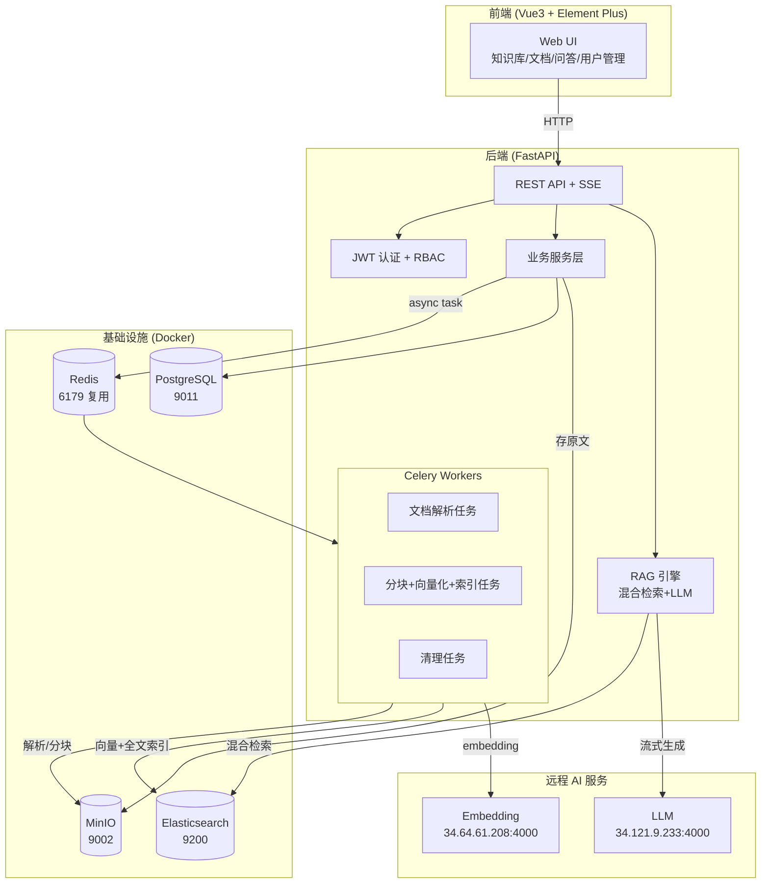

# 知识库管理系统 — 架构设计

**版本**: v1.0
**最后更新**: 2026-09-14

---

## 1. 系统总体架构



## 2. 技术栈

| 层 | 选型 |
|---|---|
| 后端框架 | FastAPI (Python 3.11) + Uvicorn |
| ORM | SQLAlchemy 2.0 + Alembic |
| 任务队列 | Celery + Redis（broker/result backend） |
| 全文+向量 | Elasticsearch 8.x（dense_vector + ik 全文，单引擎混合检索） |
| 关系库 | PostgreSQL 15 |
| 对象存储 | MinIO（S3 兼容） |
| Embedding / LLM | 远程 OpenAI 兼容 API（openai SDK） |
| 前端 | Vue 3 + Element Plus + TS + Pinia + Vite 5 |
| 认证 | JWT (access 30min + refresh 7d)，passlib[bcrypt] |
| 文档解析 | pypdf / python-docx / markdown / BeautifulSoup / 原生 |
| 测试 | pytest + httpx |

## 3. 核心设计决策

1. **单引擎混合检索**：向量与全文同存 ES 一个索引（`kb_chunks`），kNN 与 BM25 并行查询后用 RRF 融合。避免引入 Milvus 等重型向量库，降低单人维护成本。
2. **异步管道**：文档上传即落 MinIO + PG，解析/分块/向量化全部走 Celery，前端轮询 `process_task` 状态。embedding API 失败重试 3 次（指数退避）。
3. **配置化替换**：LLM / Embedding / ES / MinIO / PG 连接全部走 `.env`，便于切换供应商或环境。
4. **权限模型**：user ↔ kb 多对多（`kb_member`，role: owner/editor/viewer）。检索与 RAG 只能访问当前用户有权限的 kb。admin 可访问全部。
5. **向量存储策略**：embedding 向量存 ES `dense_vector`；PG `chunk` 表只存文本 + 元数据（用于展示与重新索引）。

## 4. 异步任务流

```
上传 → MinIO + PG(status=uploaded)
     → Celery: parse_document
        → PG(status=parsing) → 文本提取 → PG(status=parsed, full_text)
     → Celery: chunk_and_index
        → PG(status=chunking) → 分块 → 批量 embedding → ES 写入
        → PG(status=indexed, chunk_count)
```

失败：`status=failed` + `error_message`，用户可点「重新解析」回到 `parsing`。

## 5. RAG 检索流程

1. question → embedding（远程 API）
2. 并行：ES kNN（top 10）+ ES BM25（top 10）
3. RRF 融合 + 去重 → top 5 片段
4. 构建 Prompt（system + 5 片段带引用编号 + question）→ LLM stream
5. SSE 逐 token 推前端，结束时附 `sources`
6. Q&A 落 PG（conversation + message）

## 6. 安全

- JWT access(30m) / refresh(7d)，refresh 可轮换
- bcrypt 密码哈希
- Pydantic 输入校验 + SQLAlchemy 参数化查询（防 SQL 注入）
- 前端渲染 LLM 输出走 markdown + DOMPurify（防 XSS）
- 文档/知识库级 RBAC 校验在每个 API 入口

## 7. 可观测性

- 结构化 JSON 日志（loguru）
- `/api/health` 聚合 PG/ES/MinIO/Redis 健康
- Celery 任务状态可在 `process_task` 表 + 监控页查看
