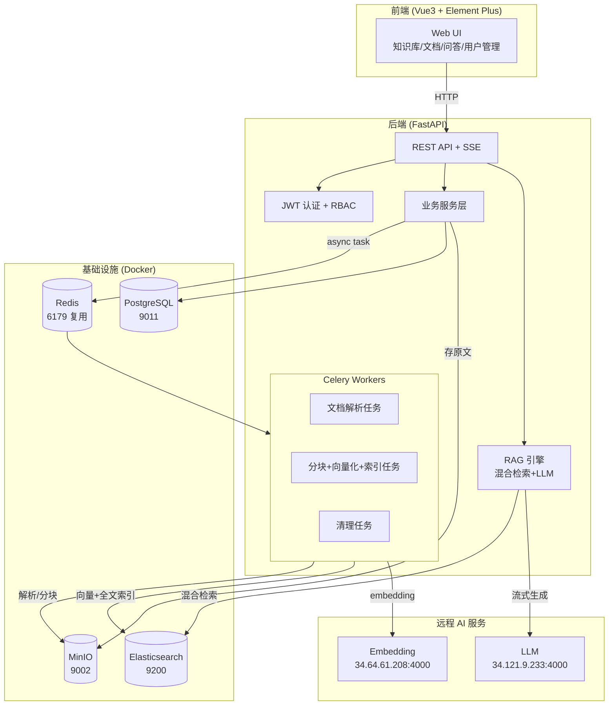

# 知识库管理系统 — 架构设计

**版本**: v1.0
**最后更新**: 2026-09-14

---

## 1. 系统总体架构



## 2. 技术栈

| 层 | 选型 |
|---|---|
| 后端框架 | FastAPI (Python 3.11) + Uvicorn |
| ORM | SQLAlchemy 2.0 + Alembic |
| 任务队列 | Celery + Redis（broker/result backend） |
| 全文+向量 | Elasticsearch 8.x（dense_vector + ik 全文，单引擎混合检索） |
| 关系库 | PostgreSQL 15 |
| 对象存储 | MinIO（S3 兼容） |
| Embedding / LLM | 远程 OpenAI 兼容 API（openai SDK） |
| 前端 | Vue 3 + Element Plus + TS + Pinia + Vite 5 |
| 认证 | JWT (access 30min + refresh 7d)，passlib[bcrypt] |
| 文档解析 | pypdf / python-docx / markdown / BeautifulSoup / 原生 |
| 测试 | pytest + httpx |

## 3. 核心设计决策

1. **单引擎混合检索**：向量与全文同存 ES 一个索引（`kb_chunks`），kNN 与 BM25 并行查询后用 RRF 融合。避免引入 Milvus 等重型向量库，降低单人维护成本。
2. **异步管道**：文档上传即落 MinIO + PG，解析/分块/向量化全部走 Celery，前端轮询 `process_task` 状态。embedding API 失败重试 3 次（指数退避）。
3. **配置化替换**：LLM / Embedding / ES / MinIO / PG 连接全部走 `.env`，便于切换供应商或环境。
4. **权限模型**：user ↔ kb 多对多（`kb_member`，role: owner/editor/viewer）。检索与 RAG 只能访问当前用户有权限的 kb。admin 可访问全部。
5. **向量存储策略**：embedding 向量存 ES `dense_vector`；PG `chunk` 表只存文本 + 元数据（用于展示与重新索引）。

## 4. 异步任务流

```
上传(index_type) → MinIO + PG(status=uploaded, meta.index_type)
     → Celery: parse_document
        → PG(status=parsing) → 文本提取 → PG(status=parsed, full_text, meta 保留 index_type)
     → Celery: chunk_and_index（按 index_type 分流）
        ├─ index_type=embedding（默认）
        │    → PG(status=chunking) → 分块 → 批量 embedding → ES 写入
        │    → PG(status=indexed, chunk_count)
        └─ index_type=pageindex（跳过分块/向量，一个文档只建一种索引）
             → Celery: build_pageindex（LLM 建树，30-120s）
                → PG(meta.pageindex_status=building) → 树写入 meta.pageindex_tree
                → PG(status=indexed)；失败 → status=failed
```

失败：`status=failed` + `error_message`，用户可点「重新解析」回到 `parsing`，或点「重建索引」按该文档 index_type 重新建索引。

## 5. RAG 检索流程

1. question → embedding（远程 API）
2. 并行：ES kNN（top 10）+ ES BM25（top 10）
3. RRF 融合 + 去重 → top 5 片段
4. 构建 Prompt（system + 5 片段带引用编号 + question）→ LLM stream
5. SSE 逐 token 推前端，结束时附 `sources`
6. Q&A 落 PG（conversation + message）

## 6. PageIndex 检索引擎（无向量、树索引 + LLM 推理）

PageIndex 是与 embedding 并列的第二种**文档级**索引方式，上传时按文档二选一（互斥，一个文档只建一种索引）：

- **embedding**（默认）：解析 → 分块 → 向量索引，走 ES 混合/向量/关键词检索。
- **pageindex**：解析 → LLM 生成层级树索引（类似"目录+摘要"，节点含标题/摘要/字符偏移 `[start,end)`），存 `document.meta["pageindex_tree"]`；检索时 LLM 在树 outline 上联合推理选 top-n 节点，按 `full_text[start:end]` 切原文作引用。

```
[PageIndex 建树]（Celery: build_pageindex，index_type=pageindex 时触发）
  full_text → (≤32k 字符分片) → LLM(vllm-qwen3.8-27b) 逐片生成子树
  → 合并成根树 → 结构校验(父⊇子/有序/覆盖度/节点数) → 失败重试1次
  → 仍失败 → 降级为 heading 规则树(status=degraded) → 写 meta.pageindex_tree

[PageIndex 检索]（search mode=pageindex / chat retrieval_mode=pageindex）
  KB 内 index_type=pageindex 且已建树的文档 → 拼 outline(每节点一行,≤80字符)
  → 单次 LLM 联合推理选 top-n 节点(带 doc 归属 + relevance 0-1)
  → 按 full_text[start:end] 切原文(截 3000) → sources 兼容格式
  → 无 pageindex 索引文档 → 空结果 + 提示（不静默回退 ES）
```

要点：
- **不用官方 SDK**，自实现（~200 行），不新增依赖；LLM 用 `vllm-qwen3.8-27b`（复用 `llm_base_url`/`api_key`，模型名走 `pageindex_llm_model` 配置）。
- **不动现有 ES / embedding / chunk 路径**（红线）；chunk 表仅作 `sources` 格式兼容锚点。
- 建树是 LLM 密集操作，**必须走 Celery 异步**（`time_limit=900`），不阻塞 API。
- 检索失败/无索引文档**不回退 ES**（mode 是用户显式选的，静默回退会造成误解），返回空 + `message` 提示。
- 检索结果 `score` = LLM 自评分（仅用于排序/top_n，不做绝对阈值）；`metadata` 带 `node_id/char_start/char_end` 可定位到段。

## 7. 安全

- JWT access(30m) / refresh(7d)，refresh 可轮换
- bcrypt 密码哈希
- Pydantic 输入校验 + SQLAlchemy 参数化查询（防 SQL 注入）
- 前端渲染 LLM 输出走 markdown + DOMPurify（防 XSS）
- 文档/知识库级 RBAC 校验在每个 API 入口

## 8. 可观测性

- 结构化 JSON 日志（loguru）
- `/api/health` 聚合 PG/ES/MinIO/Redis 健康
- Celery 任务状态可在 `process_task` 表 + 监控页查看（含 `task_type=pageindex` 建树任务）
