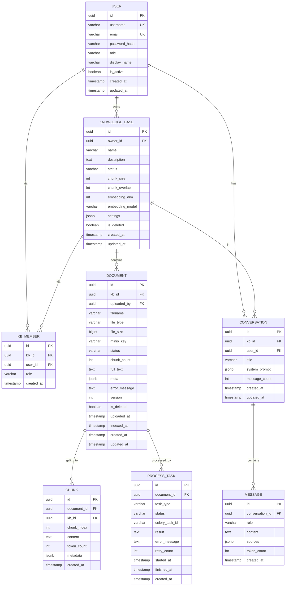

# 知识库管理系统 — 数据模型与表结构

**版本**: v1.0
**数据库**: PostgreSQL 15
**向量/全文**: Elasticsearch 8.x

---

## 1. ER 图



## 2. 表结构字典

| 表 | 说明 | 关键索引 |
|---|---|---|
| user | 系统用户 | username(UK), email(UK), role, is_active |
| knowledge_base | 知识库 | owner_id, status, name(gin_trgm), is_deleted |
| kb_member | 知识库成员(M2M+角色) | (kb_id,user_id) UK, user_id |
| document | 文档 | kb_id, status, minio_key, uploaded_by |
| chunk | 文档分块(元数据,向量在ES) | document_id, kb_id, chunk_index |
| process_task | 异步任务记录 | document_id, status, celery_task_id |
| conversation | 问答会话 | kb_id, user_id, created_at DESC |
| message | 会话消息 | conversation_id, created_at, role |

## 3. DDL 脚本

见 `infra/init_db.sql`（与后端 Alembic 初始迁移一致）。

### 3.1 变更历史

| 日期 | 变更 | 迁移 SQL |
|------|------|---------|
| 2026-09-21 | document.file_type 枚举扩展（+pptx/xlsx/jpg/png/bmp/webp/tiff）；新增 document.meta JSONB | `ALTER TABLE document DROP CONSTRAINT ck_doc_filetype; ALTER TABLE document ADD CONSTRAINT ck_doc_filetype CHECK (file_type IN ('pdf','docx','pptx','xlsx','txt','md','html','jpg','png','bmp','webp','tiff')); ALTER TABLE document ADD COLUMN meta JSONB DEFAULT '{}'::jsonb;` |

## 4. Elasticsearch 索引

```
Index: kb_chunks
mappings:
  chunk_id      keyword
  document_id   keyword
  kb_id         keyword
  chunk_index   integer
  content       text (analyzer: ik_max_word)
  embedding     dense_vector (dims=3584, similarity=cosine)
  token_count   integer
  metadata      object (dynamic)
  file_name     keyword
  file_type     keyword
  created_at    date
settings:
  number_of_shards: 1
  number_of_replicas: 0
  analysis.analyzer.ik_max_word (type: custom, tokenizer: ik_max_word)
```

> 需安装 ES 插件 `elasticsearch-analysis-ik`。
